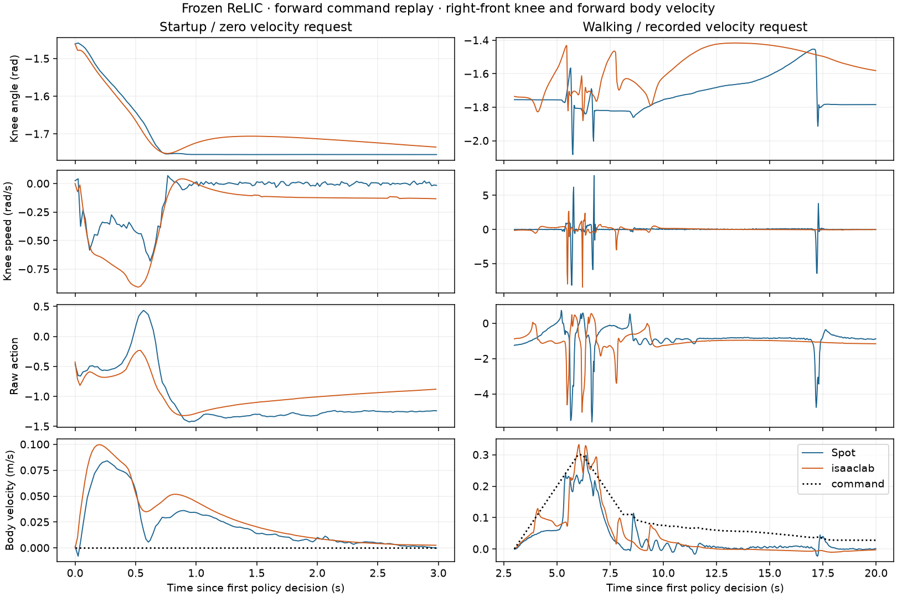

# Frozen ReLIC actuator identification

Does an actuator fit on our arm-equipped Spot predict held-out walking better
than the current simulator? One paired forward walk establishes a baseline. The
training repeats, joystick validation repeats and fitted transfer are pending.

## Paired forward replay on RPM, November 10, 2026

| Simulator and model | Mean feature W1 | Joint-feature MMD² | Policy ticks | Fall |
| --- | ---: | ---: | ---: | --- |
| Isaac Lab, current ReLIC | 2.5726 | 0.2081 | 1,000 | No |
| Isaac Lab, Table I parameters with the friction law below | 2.3832 | 0.1791 | 1,000 | No |
| MuJoCo, current ReLIC port | 5.7662 | 0.5587 | 1,000 | No |

All three use the same [forward-walk recording](../relic-forward-repeat-20261013/README.md),
initial joints, body quaternion, latched height 0.523 m, zero simulated velocities,
flat floor with friction 0.8, seed 101 and stowed arm. The released actor observes
each simulated robot. Only the effective body-frame velocity command is replayed.
History starts at zero and advances after ideal simulated delivery. Hardware history
was checked against recorded acknowledgements. There were 1,000 hardware decisions
and 1,000 action acknowledgements. The maximum timestamp displacement from the
20 ms policy grid was 5.90 ms. Each decision drives four 5 ms physics steps. The
physical run ended short of the 0.75 m goal and retains its failed status.
The right-front knee on Spot takes a late step around 17 s that the baseline
simulation misses. One trace cannot establish held-out improvement.

The Isaac articulation reported zero joint friction for all 19 joints and zero
steps of actuator delay. Both leg gains read back as Kp 60 and Kd 1.5. Hip effort
clips at 45 N·m. The native knee has a position-dependent limit and a signed
speed curve, reaching zero available driving torque at +14 and −15 rad/s. The
baseline and published-parameter model are distinct. A native versus ported
actuator probe tested 400 cases across all joints at delays zero and three.
Maximum error was 1.88e−5 N·m. The gait replay's native-versus-Exploy raw action
error stayed below 1e−6. Earlier crouch data independently gave target minus
measured position with the recorded sign, a median command interval of 4.999 ms,
p99 5.096 ms and maximum 6.373 ms across 1,126 samples.

RPM run records under `runs/sysid-pilot-20261110-{003,004,005}/RUN.md` contain exact
commands, environments and commits. Outputs are `003/mujoco`, `004/baseline`
and `005/paper` under the corresponding directories. Each contains paired.npz,
actuators.json, result.json, score.json and comparison.png. The paper cell also
includes native-audit.json and individual torque cases. The readback and pilot
use Isaac Sim 5.1 on CPU PhysX with an RTX A5500 for Kit startup. Runs 001/002
and the Isaac cell of 003 stopped before producing paired samples. Headless
startup required suppressing Kit's interactive IOMMU notice. No system settings
were changed. Baseline Isaac commit bcb8ba5, paper/audit fd4b229. Graph SHA-256
1940df208bf9e30e6134eeb71d1c4e67d3a0d66778726507d4886c62eae662e8.
The manifest, input log and source digests are in result.json and RUN.md.

## Collection and fit

1. Collect a manual demonstration using the [joystick recorder](../../docs/JOYSTICK_TELEOP.md#joystick-demonstration-recorder).
   End at rest. Register with `uv run python tools/register_sysid.py --joystick PATH/commands.jsonl --output local/study`.
   A live trial's events.jsonl can also supply the source. Registration resamples
   to 50 Hz and bounds acceleration on that grid. Inspect the four saved sequences
   and timings before collecting hardware repeats. The six-direction and random
   families use forward/lateral/yaw scales 0.18/0.12/0.25, the latter with seed 101.
2. Use `tools/joystick_relic.py prepare --profile local/study/FAMILY-profile.json --output local/FAMILY-policy`
   with project Python. Prepare the normal deployment review bundle and review its
   path, duration, support rig, tablet and current source. Open the recorder with
   that bundle for each separately approved physical trial. The operator holds
   enable with the stick centered. Keep arm, floor and rig setup consistent.
   Save five independent runs per family. Fill each entry in recordings.json with
   `{"trial":"path/to/trial","manifest":"path/to/policy/manifest.json"}`; paths
   are relative to the study directory or absolute. Preserve failed trials and
   reasons separately. Matching effective command sequences are checked on ingestion.
3. For a single offline replay, use the separate Isaac Python environment with
   `PYTHONPATH=$PWD/src:$PWD/simulation/source/relic` and `tools/sysid_replay.py
   --trial TRIAL --manifest MANIFEST --output NEW_DIR`. Select `--backend mujoco`
   with the project environment for transfer. Optional `--parameters paper`
   selects Table I and `--audit-actuators` runs the independent native clipping
   test. Score/plot with `uv run --group visualization python tools/score_sysid.py NEW_DIR MANIFEST`.
4. Fit with `uv run --group sysid python tools/fit_sysid.py fit --study local/study --sim-python /absolute/path/to/isaac/python --output runs/sysid-fit`.
   The fit reads only the three training families. Features, in policy joint
   order, are Kp*q, Kd*dq, and Kp*action_scale*raw_action (36 total). W1 uses
   equal per-feature weighting. The biased Gaussian RBF MMD² uses their joint
   distribution. Each trial contributes up to 256 evenly spaced ticks. Bandwidth
   is the median pair distance of the first training forward repeat (35.522 for
   this pilot). An initial 15%-of-search-range perturbation tests each parameter.
   A score change must exceed the median within-family real-vs-real distance
   for at least one metric to include that parameter. Others stay fixed at the
   published value. This is a local sensitivity screen.
5. Search the identifiable dimensions with CMA-ES, population 10, 100 generations,
   seed 101. Equal trial/family weighting; average the two scores normalized by
   their current-model baseline. Search bounds and implementation are in
   tools/fit_sysid.py. The port applies friction as opposing torque, smoothed
   with tanh(velocity/0.05), after native torque clipping. The four hip pairs
   share a friction value. The four knees share the other and the signed
   six-parameter speed curve. Keep the original knee angle table. This is our
   numerical implementation of the published model. Completed evaluation cells
   are reused with the original study/source/candidate. Inspect any partial cell
   before archiving it and resuming.
6. Run the same driver with `validate --fit runs/sysid-fit/fit.json`, a fresh
   output and the five held-out joystick recordings. Run again with `--backend
   mujoco` and project Python using that same fit. Determine whether both held-out
   distance reductions exceed repeat variation. Check body velocities, knee speed
   peaks and times of peak flexion (a kinematic swing proxy). For new trials the
   health stream records SDK foot contact classifications and robot timestamps
   at its own lower rate. Historical pilot data lack a per-step contact label.
   Count falls and early stops as failures. Promotion requires gait agreement
   beyond hardware repeat variability as well as both distribution scores.

The full fit needs the physical repeats. This pilot supports neither a fitted
model selection nor a hardware deployment decision. The scientific reference is
[Miller et al., sections III-B–C and Table I](https://arxiv.org/html/2504.17857v1#S3.SS2).

## Joystick and camera commissioning on RPM, November 10

The desktop driving session uses the guarded ReLIC controller in CPU MuJoCo
and a separate EGL renderer. Goal of this check was to verify the operator
inputs and room perspectives before collecting another demo. The linked FLIR
project supplied the seven-camera calibration, saved floor transform and fitted
Spot start XY/heading. Source paths and SHA-256 digests are written by the
room-array importer. Camera rotation and lens warping apply only to display.

- `runs/joystick-room-smoke-002` used the connected Logitech at neutral for
  6 simulated seconds, seed 101 and the standing fixture. It completed 300
  policy updates and 1,200 command ticks in 6.07 wall seconds. All seven JPEGs
  decoded. The 5 MP FLIR partially clips Spot in this placement. The earlier
  001 launcher failed before the simulator started.
- `runs/joystick-room-scripted-003` injected a repeatable joydev sequence with
  the same adapter and frozen policy. Maximum forward/lateral/yaw requests were
  0.110/0.052/0.159 in m/s, m/s and rad/s respectively. The trigger added one
  marker, the hat selected a camera and returned to the grid, and the arm stayed
  stowed. Button 4 ended the run. The run record includes the synthetic wrapper.
- `runs/joystick-room-ui-004` exercised the GTK Start and Stop controls with the
  actual neutral stick. The GUI received seven image buffers, the run saved
  191 policy samples and reported operator finish. The suite run in that directory
  passed 587 tests with one skip. Independent pixel round trips for 121 sample
  locations on each lens agreed within 0.06 preview pixels. This checks projection
  conventions; the commissioning did not measure physical calibration accuracy.
- The operator can now confirm physical directions by moving the stick in sim.
  The real camera receiver on port 8790 was offline during verification. Real
  frames remain unverified for this UI revision. No acquisition or robot motion
  was started. The live monitor clears expired frames and operates independently
  of controller timing.
